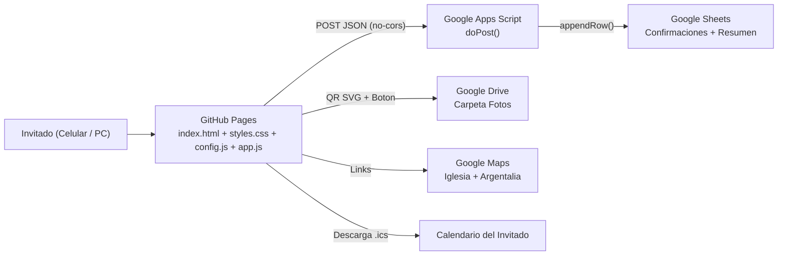

# Documentación Técnica y Guía de Continuidad — Casamiento Ignacio y Lilén (20.03.2027)

Este documento resume toda la arquitectura, archivos, integraciones externas y pasos para retomar el proyecto desde cualquier otra computadora.

---

## 1. URLs y Recursos Conectados

| Recurso | Enlace / Identificador | Notas |
| :--- | :--- | :--- |
| **Web publicada (GitHub Pages)** | https://iggarcia2.github.io/casamiento-igna-y-li/ | Rama `main`, carpeta raíz `/`, HTTPS forzado |
| **Repositorio GitHub** | https://github.com/Iggarcia2/casamiento-igna-y-li | Público, cuenta `Iggarcia2` |
| **Planilla RSVP (Google Sheets)** | https://docs.google.com/spreadsheets/d/1nDDm3WcAF4g8MtzmsxHdQ0C6Ka8rvnAVuL1oAr6RGXE/edit | Cuenta `iggarcialuis95@gmail.com` · Privada |
| **Endpoint Apps Script (RSVP)** | `https://script.google.com/macros/s/AKfycbyYFCSKLBCoQ0XuFrfe8sFk3r15st3q2Ziy03cRiYKLSfDsfcXS8bodufgcH1KVhdRyhA/exec` | Web App público que escribe en `Confirmaciones` |
| **Carpeta Fotos (Google Drive / QR)** | https://drive.google.com/drive/folders/1orB_gO9y9F0OphedrHxoBN4p_beIe2BY | Destino del QR y del botón *Subir fotos* |
| **Carpeta raíz en Drive** | https://drive.google.com/drive/folders/1cnXJot5PtmuqiL73A4Mb8-t-DIcHdQjV | Agrupa la planilla y la carpeta de fotos |

---

## 2. Arquitectura General

El proyecto es **100% estático** (**HTML5 + CSS3 + JavaScript vanilla**), sin build step ni frameworks pesados: cualquier edición que subas a `main` se publica sola en GitHub Pages en ~30–60 segundos.



---

## 3. Estructura de Archivos y Detalle del Código

```text
casamiento-igna-y-li/
├── index.html            # Estructura HTML de las 8 secciones + 2 modales + toast
├── styles.css            # Diseño mobile-first, paleta salvia/crema/dorado, modales y animaciones
├── config.js             # Configuración centralizada (editar acá datos, links, alias y textos)
├── app.js                # Lógica: hidratación, cuenta regresiva, QR, música, .ics y envío RSVP
├── apps-script/
│   └── Code.gs           # Respaldo del código pegado en Google Apps Script de la planilla
├── assets/
│   ├── foto-portada.jpg  # Foto principal vertical (placeholder actual)
│   ├── foto-pareja.jpg   # Foto secundaria horizontal (placeholder actual)
│   ├── eucalipto.jpg     # Ilustración botánica acuarela (se funde con mix-blend-mode: multiply)
│   └── musica.mp3        # (A agregar por los novios para el botón DALE PLAY!)
├── README.md             # Guía rápida del repositorio
└── DOCUMENTACION.md      # Esta guía completa de continuidad
```

### 3.1 `config.js` — Fuente única de verdad
Expone `window.WEDDING_CONFIG` con toda la información editable sin tocar HTML ni JS:
- **Fechas y nombres:** `coupleNames` (`"Ignacio y Lilén"`), `dateDisplay` (`"20.03.2027"`), `eventDateISO` (`"2027-03-20T19:00:00-03:00"`), `eventEndISO`.
- **Música:** `musicFile: "assets/musica.mp3"`.
- **Eventos (`events[]`):**
  1. `Ceremonia`: `19:00 Hs.` — `IGLESIA SAN FRANCISCO` (`Alvear 620 · Río Cuarto, Córdoba`) + link a Google Maps.
  2. `Fiesta`: `20:30 Hs.` — `RECREO ARGENTALIA` (`Ex Ruta 36 · Río Cuarto, Córdoba`) + link a Google Maps.
- **RSVP (`rsvp`):** `deadlineText`, `googleScriptUrl` (ya conectada y probada) y `whatsappFallback` (opcional).
- **Regalos / Datos bancarios (`gift`):** `alias` (`"A.DEFINIR.IGNA.LI"`), `aliasPendingNote`, `cbu` (si queda vacío se oculta solo), `bank`, `holder`.
- **Dress Code (`dressCode`):** `style` (`"ELEGANTE · GALA · ELEGANTE SPORT"`), `reservedTitle`, `reservedNote` y array `reservedColors` con los 6 tonos reservados para Lilén (`Blanco`, `Blanco roto`, `Marfil`, `Crema`, `Champagne`, `Beige claro`).
- **Fotos (`photos`):** `driveUrl` apuntando a la carpeta de Drive y texto del botón.
- **Imágenes (`images`):** rutas a `hero`, `couple` y `eucalyptus`.

### 3.2 `index.html` — Secciones y Modales
Usa Google Fonts (`Cormorant Garamond`, `Great Vibes`, `Montserrat`) y `qrcode-generator@1.4.4` (desde jsDelivr) para generar el QR en el navegador.

Secciones en orden:
1. **Portada (`#inicio`):** foto a sangre completa (`100svh`), degradado para legibilidad, `¡NOS CASAMOS!`, `Ignacio & Lilén`, `20.03.2027` y botón circular `DALE PLAY!` con `<audio id="bg-audio" loop>`.
2. **Frase + Cuenta Regresiva (`#cuenta-regresiva`):** fondo verde salvia, frase emotiva, `Faltan`, reloj en vivo `DÍAS : HORAS : MINUTOS : SEGUNDOS` y ramita de eucalipto.
3. **Ceremonia y Fiesta (`#eventos`):** fondo papel texturado crema, se renderiza dinámicamente desde `config.js` con íconos SVG lineales + botón `AGENDAR FECHA`.
4. **Confirmá tu presencia + Regalos (`#confirmar`):** ornamento dorado con corazón SVG, texto límite, botón `Confirmar` (abre `#modal-rsvp`), separador y botón `Ver datos` (abre `#modal-gift`).
5. **Dress Code + Colores reservados (`#dress-code`):** tarjeta crema con chinche verde e ilustración SVG de vestido/traje, eucalipto divisor y grilla 3×2 de muestras de colores reservados para la novia (con línea diagonal sutil).
6. **Fotos + QR (`#fotos`):** ícono cámara con corazón, tarjeta con `<div id="qr-code">` (SVG generado dinámicamente) y botón `SUBIR FOTOS AL DRIVE`.
7. **Foto secundaria:** imagen horizontal a ancho completo (`assets/foto-pareja.jpg`).
8. **Footer (`#cierre`):** marca de agua de anillos dorados entrelazados (guiño al video *Save the Date*), corazón dorado, `¡TE ESPERAMOS!`, `Ignacio y Lilén`, `20 · 03 · 2027` y eucalipto inferior.

Modales:
- **`#modal-rsvp`:** formulario completo con campos condicionales (oculta cantidad/menú/canción si elige "No podré asistir", y muestra "Nombres de los acompañantes" solo si elige 2 o más personas).
- **`#modal-gift`:** muestra Alias con botón `COPIAR ALIAS` (y CBU si se configura en `config.js`).

### 3.3 `styles.css` — Estética y Tokens
- **Paleta CSS (`:root`):**
  - `--sage-bg: #c4d5c0` (verde salvia principal)
  - `--sage-btn: #88a487` (botones sobre fondo salvia)
  - `--olive-dark: #354929` (botones principales y acentos oscuros)
  - `--paper-bg: #f8f7f2` (papel crema texturado)
  - `--gold: #c6a95d` (ornamentos dorados)
- **Layout:** *mobile-first* con `.invitation-shell` centrado a `max-width: 460px` en escritorio (con bordes redondeados y sombra suave sobre fondo botánico).
- **Detalles clave:**
  - `[hidden] { display: none !important; }` asegura que campos ocultos en modales no sean pisados por `display: flex`.
  - `.botanical-sprig { mix-blend-mode: multiply; }` integra la acuarela sobre el fondo salvia sin bordes blancos.
  - `.reveal` + `.is-visible` animan suavemente la aparición de cada sección al scrollear (respetando `prefers-reduced-motion`).

### 3.4 `app.js` — Lógica Interactiva
- `hydrateContent()`: inyecta textos, eventos, muestras de colores, datos bancarios y el link de Drive desde `WEDDING_CONFIG`.
- `renderQrCode(url)`: genera el QR en SVG tintado en `#354929` usando `window.qrcode(0, "M")`.
- `initCountdown()`: actualiza cada 1 segundo el tiempo restante hacia `eventDateISO`.
- `initMusicPlayer()`: alterna reproducción/pausa del `<audio>`; si aún no existe `assets/musica.mp3`, avisa con un toast amigable.
- `initCalendarButton()`: arma y descarga el archivo `casamiento-ignacio-y-lilen.ics`.
- `initModals()`: abre/cierra modales por botón, clic fuera o tecla `Escape`, y maneja la copia al portapapeles (`navigator.clipboard` con fallback).
- `initRsvpForm()`: valida nombre, arma el JSON y hace `fetch(googleScriptUrl, { method: "POST", mode: "no-cors", headers: { "Content-Type": "text/plain;charset=utf-8" }, body: JSON.stringify(payload) })`.

### 3.5 Google Sheets + `apps-script/Code.gs`
La planilla `Casamiento Ignacio y Lilén - Confirmaciones` tiene:
- **Locale:** `es_AR` · **Zona horaria:** `America/Argentina/Cordoba`.
- **Pestaña `Confirmaciones`:** encabezados en `A1:H1` (fila 1 congelada), validaciones desplegables en columna `C` (`Sí,No`) y columna `F` (tipos de menú).
- **Pestaña `Resumen`:** fórmulas automáticas (`COUNTA`, `COUNTIF`, `SUMIF` con separador `;`) que cuentan respuestas, personas confirmadas, ausencias y cada restricción alimentaria.
- **Apps Script (`doPost`):** recibe el JSON del formulario, genera la marca temporal en hora de Córdoba (`dd/MM/yyyy HH:mm`) y agrega una fila en `Confirmaciones`. *(Nota: si algún día modificás el código en Apps Script, recordá usar **Implementar → Administrar implementaciones → Editar (lápiz) → Nueva versión** para conservar la misma URL).*

---

## 4. Cómo Seguir Trabajando desde Otra Computadora

### 4.1 Clonar el repositorio
```bash
git clone https://github.com/Iggarcia2/casamiento-igna-y-li.git
cd casamiento-igna-y-li
```

### 4.2 Previsualizar localmente antes de subir cambios
Con Python (o cualquier servidor estático como Live Server en VS Code):
```bash
python -m http.server 8000
```
Luego abrí `http://localhost:8000` en el navegador (ideal verlo en modo móvil desde DevTools con `F12`).

### 4.3 Publicar cambios en GitHub Pages
```bash
git add .
git commit -m "Actualizar fotos y alias"
git push origin main
```
En ~30–60 segundos GitHub Pages actualiza automáticamente https://iggarcia2.github.io/casamiento-igna-y-li/.

---

## 5. Checklist de Pendientes para Versión Final

- [ ] **Fotos definitivas:** reemplazar `assets/foto-portada.jpg` (vertical) y `assets/foto-pareja.jpg` (horizontal).
- [ ] **Canción:** agregar el archivo `assets/musica.mp3` para activar el botón `DALE PLAY!`.
- [ ] **Alias / CBU definitivo:** actualizar `gift.alias` (y borrar `gift.aliasPendingNote`) en `config.js`.
- [ ] **Permisos de carga en Google Drive:** abrir [Fotos - Casamiento Ignacio y Lilén](https://drive.google.com/drive/folders/1orB_gO9y9F0OphedrHxoBN4p_beIe2BY) → *Compartir* → *Cualquier persona con el enlace* → rol **Editor**.
- [ ] **Limpiar pruebas:** borrar la fila de test de la pestaña `Confirmaciones` en la [planilla de Google Sheets](https://docs.google.com/spreadsheets/d/1nDDm3WcAF4g8MtzmsxHdQ0C6Ka8rvnAVuL1oAr6RGXE/edit) antes de enviar la invitación a los invitados.
